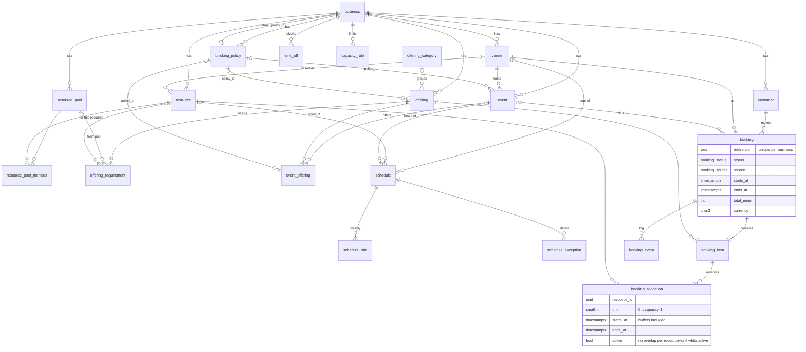

# Booking service schema v1

The booking service owns time, availability, capacity and bookings for any business that takes appointments: photographers, barbershops, hair and nail salons, spas. It lives in the `booking` Postgres schema of the shared Supabase project. The photography site is its first client and talks to it over HTTP.

Source of truth: [`supabase/migrations`](../supabase/migrations). Reference data: [`supabase/seed.sql`](../supabase/seed.sql). Linear: [NOR-58](https://linear.app/nordo-tech/issue/NOR-58/booking-service-domain-model-and-database-schema-v1).

## Diagram

`api_client`, `webhook_endpoint`, `outbox_event`, `question`, `booking_answer` and `waitlist_entry` are left out to keep it readable; each belongs to a business like everything else.

## Concepts

| Concept           | What it is                                                                                                                                         | Photography                                                 | Barbershop / salon                             |
| ----------------- | -------------------------------------------------------------------------------------------------------------------------------------------------- | ----------------------------------------------------------- | ---------------------------------------------- |
| **Business**      | The tenant. Time zone, currency, locale.                                                                                                           | Melvin Calderón Photography                                 | Barbería El Corte                              |
| **Venue**         | Where the service happens: on site, at the customer's address, or online. Can have its own opening hours.                                          | The studio; "outdoor, place agreed with the client"         | Each branch                                    |
| **Resource**      | Something with limited time: a person (staff), a space or equipment. Capacity = how many bookings it can serve at the same time.                   | Melvin (staff); the Christmas set (space)                   | Each barber; each wash station                 |
| **Resource pool** | A group of interchangeable resources. Says whether the customer picks one or gets "any available".                                                 | —                                                           | "Barberos" (customer may choose)               |
| **Offering**      | What a customer books: duration, buffers, price, party size, and which resources it needs.                                                         | Mini sesión 20 min; Sesión familiar 40 min                  | Corte 30 min; Barba 15 min; Color 2 h          |
| **Event**         | A time-boxed offer at a venue, with its own dates, hours, offerings, limits and policy. Optional: businesses with year-round hours don't need one. | Navidad 2026 en el set (28 nov – 21 dic)                    | Día de las Madres promo                        |
| **Schedule**      | Weekly hours in local time, plus date exceptions (extra day, closed day). Belongs to a venue, a resource or an event.                              | Event hours Thu–Sun 9:00–17:00, with extra and blocked days | Each barber's shifts                           |
| **Time off**      | A block in absolute time for the business, a venue, a resource or an event.                                                                        | "Bloquear tiempo" in the calendar                           | Barber on vacation                             |
| **Capacity rule** | A limit on bookings or people per slot, day, week or in total, for an event, offering, resource or venue. The strictest rule wins.                 | 12 per day, 160 per season                                  | 1 per barber at a time (implicit)              |
| **Policy**        | Approval mode, hold minutes, response deadline, lead time, booking window, cancellation cutoff, reminder times.                                    | Manual approval, 10-min holds                               | Instant, cancel up to 2 h before               |
| **Customer**      | Belongs to one business. Matched by email or phone; WhatsApp-first, so phone is stored in E.164.                                                   | Familia Taveras                                             | Walk-in client                                 |
| **Booking**       | One reservation by one customer. It contains booking items, and each item reserves resources through allocations.                                  | One mini session                                            | Cut + beard, back to back with the same barber |

## Mapping from the photography app's old entities

| Old              | New                                                                    |
| ---------------- | ---------------------------------------------------------------------- |
| Plan             | `event`                                                                |
| Package          | `offering` + `event_offering`                                          |
| AvailabilityRule | `schedule` + `schedule_rule`                                           |
| Blackout         | `time_off`, or a `schedule_exception` when it closes a whole event day |
| Client           | `customer`                                                             |
| Booking          | `booking` (+ `booking_item`, `booking_allocation`)                     |
| WaitlistEntry    | `waitlist_entry`                                                       |

These stay in the photography app: studio site settings, User, Membership, Page, Gallery, Photo, the marketing Service cards, EmailTemplate, EmailLog and Inquiry. The app maps each studio to a `business_id` (`business.external_ref` holds the app's id).

## Rules the schema enforces

- **Tenancy.** Every table except `business` has `business_id` and an index that starts with it. Every reference between tenant tables is a composite `(business_id, id)` foreign key, so a row can't point at another business's data.
- **Access.** RLS is enabled and forced on every table, with no policies. Only `service_role` has grants; `anon` and `authenticated` can't even see the schema.
- **Uniques.** `business.slug`; `event (business_id, slug)`; `booking (business_id, reference)`; `booking (business_id, idempotency_key)`; `customer (business_id, email)`. Emails are stored trimmed and lower-case, phones in E.164.
- **Money.** Integer minor units plus an ISO 4217 code. `booking_item.price_minor` and `currency` are a snapshot taken at booking time. `booking.payment_status` is reserved until payments land ([NOR-108](https://linear.app/nordo-tech/issue/NOR-108/deposits-and-payments-with-stripe)).
- **No overbooking.** `booking_allocation` has an exclusion constraint: no two active allocations overlap on the same resource and unit. A resource with capacity `n` has units `0..n-1`; a trigger rejects units outside that range.
- **Allocations follow status.** When a booking leaves `hold`, `pending` or `confirmed`, a trigger deactivates its allocations.
- **Policy order.** `booking.resolve_policy(business, offering, event)` returns the first policy set on the event-offering, then the event, then the offering, then the business default. `resolvePolicy` in `packages/booking` does the same, and a test checks they agree.

## Time

- Instants (`booking`, `booking_allocation`, `time_off`) are `timestamptz`, stored in UTC.
- Schedules (`time`, weekday 0 = Sunday) and event dates (`date`) are local wall time in the venue's time zone, falling back to the business's.
- Local times are converted per date, so DST is handled even though Santo Domingo has none. A wall time skipped by spring-forward moves forward by the gap; a repeated one takes its first occurrence.

## How availability works

`findSlots(context, request)` in `packages/booking/src/slots.ts` is pure; `loadAvailabilityContext` reads the rows it needs.

1. **Resolve the context.** Event (must be published and inside its publish window), venue, offerings (with event overrides for duration and price) and the policy for each item. With several items, the strictest policy value wins.
2. **Find open time.** Intersect venue hours with event hours. A resource is open where its own hours (if any) meet that. If nothing involved has a schedule, it is closed. Subtract time off for the business, the venue, the event and the resource.
3. **Generate start times** on the event grid, else the first offering's `slot_interval_min`, else the business's. Flexible events use a 5-minute grid. Keep starts inside the lead time and booking window.
4. **Assign resources.** Each requirement becomes a segment of the service: `offset_min` and `length_min` let a colour hold the stylist for 0–30 and 75–120 but the wash station only for 0–15. Segments with the same `link_key` share a resource. In a sequential multi-item booking, items drawing from the same pool share a resource (cut and beard with the same barber); in a parallel one they don't (manicure and pedicure by two technicians). The customer's choice is used when the pool allows it; otherwise the least-booked resource that day goes first.
5. **Apply capacity rules.** Confirmed bookings and live holds always count; pending ones count when the policy says so. Expired holds are ignored even before the cleanup job releases them.
6. **Return slots** with their items, allocations and `remaining` (bookings left under the tightest booking-count rule).

Buffers apply at the edges of a booking: `buffer_before_min` to segments that start the booking, `buffer_after_min` to segments that end it. Allocations include buffers; the service span must fit inside opening hours, buffers may not.

The write path (a Postgres function that takes `pg_advisory_xact_lock` per business and re-checks steps 4–5) comes with [NOR-78](https://linear.app/nordo-tech/issue/NOR-78/capacity-limits-engine) and [NOR-82](https://linear.app/nordo-tech/issue/NOR-82/booking-submission-and-status-state-machine). It must release expired holds before inserting, or their still-active allocations will trip the exclusion constraint.

## Changes from the draft in the ticket

- **Typed scope columns instead of `owner_type` / `scope_type` + `scope_id`.** `schedule`, `time_off`, `capacity_rule` and `question` have one nullable foreign key per possible owner, with a check on how many are set. This gives real foreign keys and cascades. For `time_off` and `question`, no column set means the whole business.
- **`booking_allocation.unit`** so the exclusion constraint also covers resources with capacity above one.
- **`booking_allocation.booking_id`**, alongside `booking_item_id`, so status changes and reads don't need a join.
- **`business.slot_interval_min`** and **`offering.slot_interval_min`** as grid fallbacks when there is no event.
- **`capacity_rule.period`** and **`max_count`** instead of `window` and `max`, which are SQL keywords.
- **`reminder_offsets_min`**, `scopes` and `event_types` are Postgres arrays, not JSON.

## Seed data

`supabase/seed.sql` holds the four reference businesses. `packages/booking/test/seed.test.ts` asserts their slots with now = 2026-11-20 12:00 UTC.

| Business                    | What it shows                                                                                                                                                                                                                      |
| --------------------------- | ---------------------------------------------------------------------------------------------------------------------------------------------------------------------------------------------------------------------------------- |
| Melvin Calderón Photography | Christmas event, 28 Nov – 21 Dec, Thu–Sun 9–17, extra Monday 21 Dec, closed Sunday 13 Dec. Manual approval, 20-minute grid, 12 a day, 160 in total. A full day, a day with pending and expired-hold bookings, and a blocked lunch. |
| Barbería El Corte           | Three barbers with different shifts in a customer-choice pool; one on vacation. Cut + beard back to back with the same barber.                                                                                                     |
| Salón Bella                 | Colour that needs the stylist at 0–30 and 75–120 and a wash station at 0–15, so the stylist can take a cut while it processes.                                                                                                     |
| Nails & Co                  | Manicure and pedicure in parallel by two technicians, including a seeded two-item booking.                                                                                                                                         |
